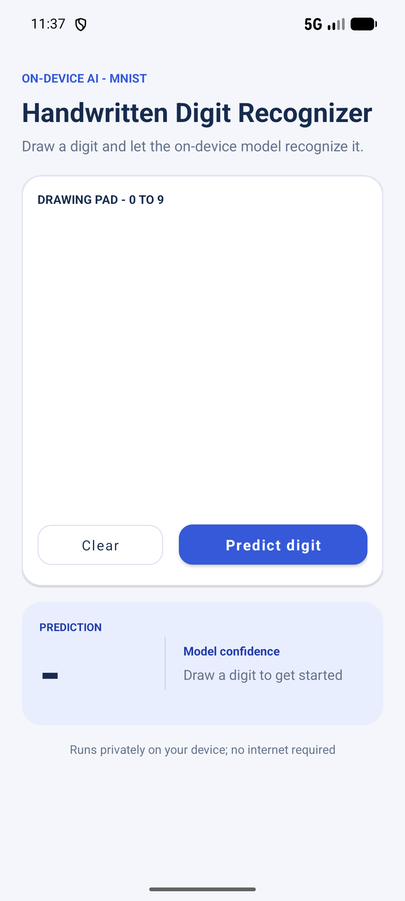
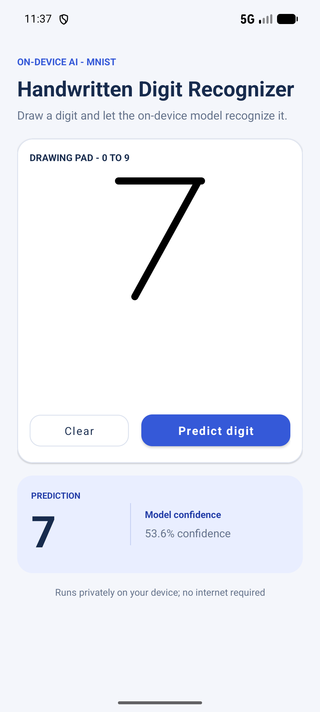

# Handwritten Digit Recognizer

A small native Android application built with Java, XML, and TensorFlow Lite. The user draws one digit from 0 to 9; a CNN trained on MNIST classifies the drawing locally and displays the digit and model score. The model is bundled in the app, and the manifest requests no network permission.

## Open and run

1. Open this folder in Android Studio.
2. Install Android SDK 35 if it is not already installed.
3. In Settings > Build Tools > Gradle, select Gradle JDK 21.
4. Sync the project, start an API 24 or newer emulator/device, and press Run.
5. Draw a digit in the pad and choose Predict digit. Choose Clear to reset.

PowerShell build command:

    .\gradlew.bat assembleDebug

The debug APK is generated at app/build/outputs/apk/debug/app-debug.apk.

## Project layout

- app/src/main/java/.../MainActivity.java - lifecycle, buttons, input checks, and result display
- app/src/main/java/.../DrawingView.java - touch events, Path drawing, and Bitmap snapshots
- app/src/main/java/.../DigitClassifier.java - asset mapping, preprocessing, and TFLite inference
- app/src/main/res/layout/activity_main.xml - XML screen
- app/src/main/assets/digit_model.tflite - trained ten-class model used offline
- ml/train_mnist.py - optional MNIST training and TensorFlow Lite conversion
- docs/CODE_WALKTHROUGH.md - beginner-friendly explanation of the classes and execution flow
- docs/TESTING.md - build, model, and Pixel 6 emulator results
- docs/screenshots/ - genuine screenshots captured from the Pixel 6 AVD

## Retrain the model (optional)

Model preparation needs Python 3.10 to 3.13 and internet access for Keras to download MNIST on its first run. Android runtime and inference are Java-only.

    python -m pip install tensorflow-cpu==2.20.0
    python ml/train_mnist.py

The script trains a small CNN, prints its held-out MNIST accuracy, and overwrites app/src/main/assets/digit_model.tflite with the converted model.

## Training and data acknowledgment

The model is trained on the MNIST handwritten digit dataset by Yann LeCun, Corinna Cortes, and Christopher J. C. Burges. TensorFlow/Keras loads the dataset and TensorFlow Lite converts the trained model. The app uses the model confidence score as a score, not a guarantee of correctness.

## Verification note

Gradle build and Pixel 6 emulator checks are recorded in docs/TESTING.md. The current TensorFlow Lite JNI library triggers Android's 16 KB page compatibility warning on the Android 16 emulator; the app ran successfully in compatibility mode. See that checklist for the recorded drawing outcomes and the one real misclassification.
## Screenshots

| Drawing pad | Example prediction |
| --- | --- |
|  |  |

## How inference works

DrawingView records finger strokes and returns a Bitmap. DigitClassifier crops the ink, fits it into a 20 x 20 region, centers it in a 28 x 28 image, inverts and normalizes pixels, and runs the bundled model. MainActivity displays the highest-scoring digit and releases the interpreter when the screen is destroyed.

- Input: float32 `[1, 28, 28, 1]`
- Output: float32 `[1, 10]`, classes 0 through 9
- Model: `app/src/main/assets/digit_model.tflite`

## Reference

The [NumberGuessingAppTflite repository](https://github.com/Uzair390-Del/NumberGuessingAppTflite) provided a reference for asset loading and Interpreter integration. This app implements its own drawing interface, image preprocessing and MNIST classifier. See the [code walkthrough](docs/CODE_WALKTHROUGH.md) and [recorded testing results](docs/TESTING.md).
